<!--
  Profile README for github.com/Guggi99.
  GitHub shows this file on the profile front page because the repo is named
  exactly like the account (Guggi99/Guggi99) and is public.
  Everything else on the account stays private.
-->

## Hi, I'm Peter

RF, satellite and power electronics systems engineer with about 30 years in the field, now also doing an MSc in Computer Science at EPFL.

I work where radio-frequency hardware, embedded systems and machine learning meet.

<!--
  LinkedIn badge, hidden until the handle is filled in.

  

-->

---

#### Background

**Career**
- CGO and CIT, [SWISSto12](https://swissto12.com/), Renens (current)
- Former CEO, RUAG Space
- Former CEO, ABB Power Automation Products
- Board member, Aerosuisse, representing the space sector

**Education**

Apprenticeship in electronics → HTL engineering degree → ETH Zurich, computer science and electronics → PhD → now MSc Computer Science, EPFL

---

#### Languages and Tools

#### Where I started

---

#### GitHub Stats

  
  

